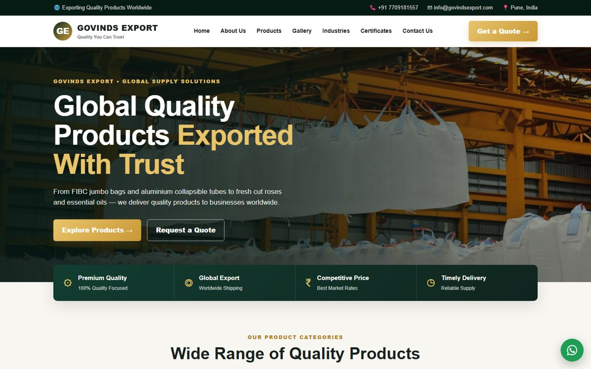

# Govinds Export — Website

Official website of **Govinds Export**, an export company in Talegaon Dabhade, Pune, India. It supplies FIBC jumbo bags, aluminium collapsible tubes, fresh cut roses and essential oils to buyers worldwide.



## Features

- **Product pages** for the four product lines, each with HSN codes, variants and photos.
- **Gallery** of 42 product photos with category filters and a full-screen viewer. You can swipe on phones and use the arrow keys on desktop.
- **Quote form** that sends the buyer's request to WhatsApp or email with the details already filled in. It needs no server.
- **Phone-first layout** with a slide-down menu and a floating WhatsApp button.
- **Export documents section** for GST, IEC, RCMC and other certificates, which will be uploaded soon.
- **No build step.** It's plain HTML, CSS and JavaScript, with no frameworks or dependencies.

## Project structure

```
index.html              the page
css/styles.css          layout and sections
css/interactive.css     gallery, viewer, quote form, phone layout
js/main.js              menu, quote form, gallery filter, viewer
assets/images/          photos in bags/, tubes/, roses/, oils/
                        (name.jpg up to 1600px, name-sm.jpg at 600px)
vercel.json             hosting config (caching and security headers)
```

## Run locally

Any static file server works. With Python:

```bash
python -m http.server 8090
```

Then open http://localhost:8090.

## Deploy on Vercel

1. In Vercel, choose **Add New → Project** and import this GitHub repository.
2. Set **Framework Preset** to *Other*. Leave the build command and output directory empty.
3. Click **Deploy**.

Each push to `main` then redeploys the site automatically.

## Updating content

| What | Where |
|---|---|
| WhatsApp number and email for quotes | top of `js/main.js` |
| Phone, email and address shown on the page | `index.html` (top bar and footer) |
| Products, variants and HSN codes | the `#products` section in `index.html` |
| Gallery photo | add `name.jpg` and `name-sm.jpg` to `assets/images/<category>/`, then add a `gallery-item` line in `index.html` |

## Contact

📞 +91 7709181557 · ✉ info@govindsexport.com · 📍 Office No. 5, VTP Bhagyasthan, Yash Evaana Road, Talegaon Dabhade, Pune 410507

---

© Govinds Export. All rights reserved. The product photos and brand belong to Govinds Export.
